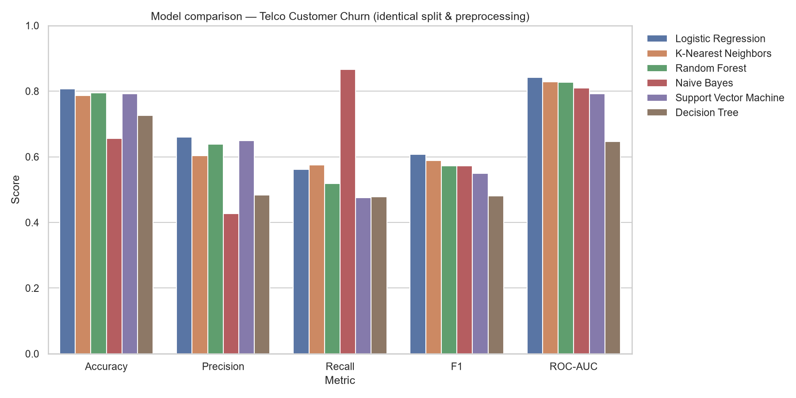
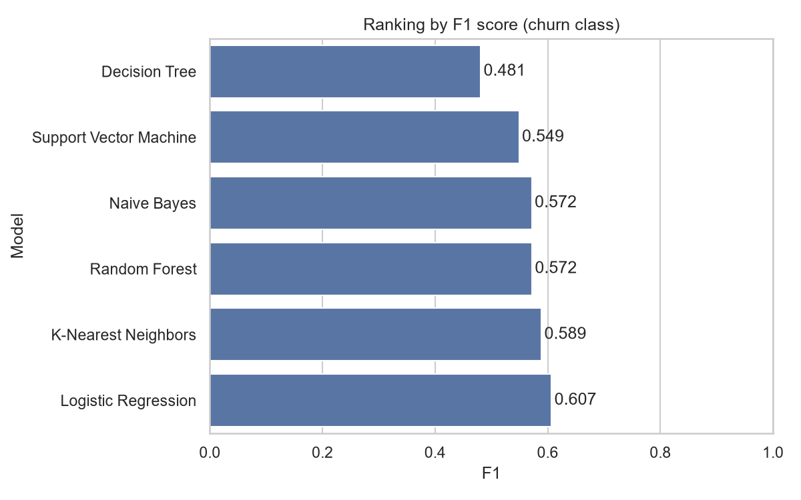
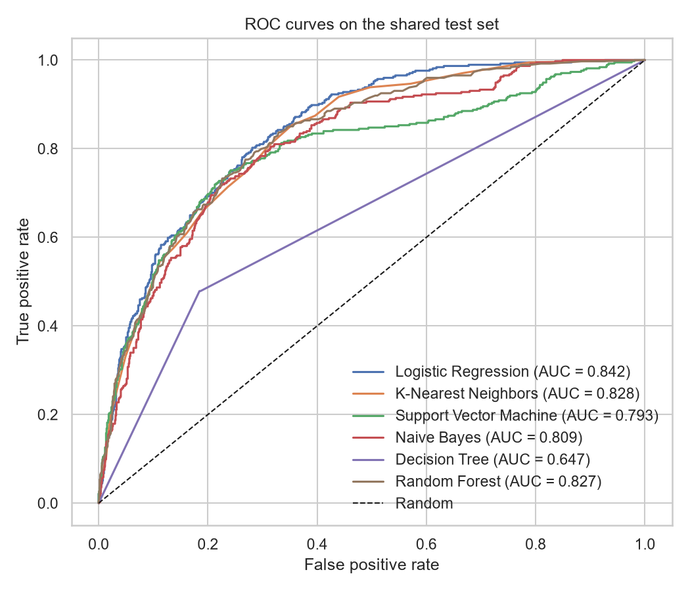
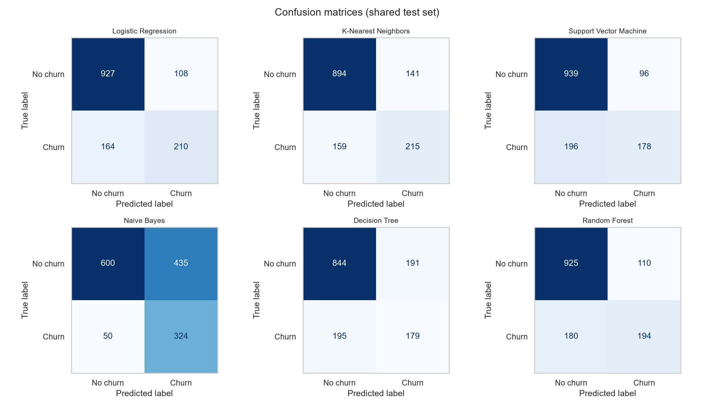

# Supervised Machine Learning Benchmark & Algorithms from Scratch

A comprehensive machine learning repository containing two key empirical studies:
1. **Supervised Learning Benchmark: Comparative Study of 6 Classification Algorithms** — evaluated on the **Telco Customer Churn** dataset under identical split, preprocessing, and evaluation pipeline conditions.
2. **Linear Regression from Scratch with NumPy** — vectorized implementation of hypothesis, Mean Squared Error (MSE) cost function, and gradient descent on the **California Housing** dataset, mathematically verified against `scikit-learn`.

---

## Table of Contents
- [Supervised Learning Benchmark: 6 Classification Algorithms](#supervised-learning-benchmark-6-classification-algorithms)
  - [1. Dataset Overview](#1-dataset-overview)
  - [2. Experimental Setup & Preprocessing](#2-experimental-setup--preprocessing)
  - [3. Benchmark Results & Model Rankings](#3-benchmark-results--model-rankings)
  - [4. Visualizations](#4-visualizations)
  - [5. Analysis & Insights](#5-analysis--insights)
- [Linear Regression from Scratch (NumPy)](#linear-regression-from-scratch-numpy)
  - [1. Mathematical Formulation](#1-mathematical-formulation)
  - [2. Vectorized Gradient Derivation](#2-vectorized-gradient-derivation)
  - [3. Validation against Scikit-Learn](#3-validation-against-scikit-learn)
- [Repository Structure](#repository-structure)
- [Installation & Reproduction](#installation--reproduction)
- [Future Enhancements](#future-enhancements)

---

## Supervised Learning Benchmark: 6 Classification Algorithms

A comparative study of supervised classification algorithms trained and evaluated on the **Telco Customer Churn** dataset under strictly controlled conditions — identical rows, identical train/test split, shared preprocessing pipelines, and consistent metrics. The goal is not merely optimizing accuracy, but analyzing *which algorithm families suit this domain, and why*.

### 1. Dataset Overview

**Telco Customer Churn** — 7,043 customers of a fictional telecom provider, 19 features, binary target (`Churn`: Yes/No).
Source: IBM sample dataset, widely mirrored on Kaggle. Located at [`data/Telco-Customer-Churn.csv`](data/Telco-Customer-Churn.csv).

| Property | Value |
|---|---|
| **Rows** | 7,043 |
| **Features** | 19 (4 numeric, 15 categorical) |
| **Target** | `Churn` — 26.5% positive, 73.5% negative (imbalanced) |
| **Missing Values** | 11 blank `TotalCharges` (all `tenure = 0`) |
| **Post-Encoding Features** | 30 features |

> **Note on Evaluation:** Predicting "nobody churns" yields 73.5% accuracy while being business-useless. Therefore, models are ranked primarily by **F1 Score on the Churn class**, with ROC-AUC as a threshold-independent secondary measure.

---

### 2. Experimental Setup & Preprocessing

To ensure a fair comparison:
1. **Identical Split:** `train_test_split(test_size=0.20, random_state=42, stratify=y)` produces 5,634 training and 1,409 testing samples.
2. **Data Cleaning:** `customerID` dropped; 11 missing `TotalCharges` values imputed with `0.0` (as `tenure = 0`); target binary encoded (0/1).
3. **Categorical Encoding:** `OneHotEncoder(drop="first", handle_unknown="ignore")` applied uniformly across 15 categorical columns.
4. **Selective Feature Scaling:** `StandardScaler` applied for distance/magnitude-sensitive models (Logistic Regression, KNN, SVM, Naive Bayes). Tree-based models (Decision Tree, Random Forest) receive unscaled numeric features since decision trees are scale-invariant.
5. **Leakage Prevention:** All preprocessing steps operate within `scikit-learn` `Pipeline` instances to prevent data leakage from test set / cross-validation folds.

---

### 3. Benchmark Results & Model Rankings

Models ranked by **F1-Score on the Churn class** (Test set, $n = 1,409$):

| Rank | Model | Accuracy | Precision | Recall | **F1 Score** | ROC-AUC | 5-Fold CV F1 (Train) |
|---:|---|---:|---:|---:|---:|---:|---:|
| 1 | **Logistic Regression** | **0.8070** | 0.6604 | 0.5615 | **0.6069** | **0.8422** | 0.593 ± 0.030 |
| 2 | K-Nearest Neighbors ($k=25$) | 0.7871 | 0.6039 | 0.5749 | 0.5890 | 0.8281 | 0.595 ± 0.015 |
| 3 | Random Forest (300 trees) | 0.7942 | 0.6382 | 0.5187 | 0.5723 | 0.8272 | 0.546 ± 0.027 |
| 4 | Naive Bayes (Gaussian) | 0.6558 | 0.4269 | **0.8663** | 0.5719 | 0.8092 | 0.582 ± 0.010 |
| 5 | Support Vector Machine (RBF) | 0.7928 | **0.6496** | 0.4759 | 0.5494 | 0.7928 | 0.570 ± 0.016 |
| 6 | Decision Tree (unpruned) | 0.7260 | 0.4838 | 0.4786 | 0.4812 | 0.6465 | 0.503 ± 0.023 |

- **Full per-class reports:** [`results/classification_reports.txt`](results/classification_reports.txt)
- **Raw CSV data:** [`results/comparison_table.csv`](results/comparison_table.csv)
- **Summary JSON:** [`results/summary.json`](results/summary.json)

---

### 4. Visualizations

| Model Comparison Metrics | F1 Ranking |
|:---:|:---:|
|  |  |

| ROC Curves | Confusion Matrices |
|:---:|:---:|
|  |  |

---

### 5. Analysis & Insights

#### Why Logistic Regression Won
Logistic Regression outperformed more complex non-linear models on this dataset due to three structural features:
- **Additive Linear Signal:** Coefficient analysis indicates independent linear risk factors: `Contract_Two year` (-1.33) and `tenure` (-1.25) decrease churn risk, while `InternetService_Fiber optic` (+1.18), `TotalCharges` (+0.52), and `PaymentMethod_Electronic check` (+0.38) increase risk.
- **Sparse One-Hot Feature Space:** 26 of 30 post-encoding features are binary, making a linear boundary equivalent to a weighted indicator vote.
- **Low Variance Regime:** In a dataset with moderate size (5,634 training rows) and noise, low-variance linear estimators avoid fitting sample noise, achieving the highest ROC-AUC (0.8422).

#### Why Unpruned Decision Tree Overfit
An unpruned Decision Tree suffered severe overfitting:
- Train Accuracy: **99.80%** vs. Test Accuracy: **72.60%**
- Grew to **depth 23 with 1,102 leaf nodes** (~1 leaf per 5 training samples), memorizing noise.
- **Ensemble Improvement:** Ensembling 300 decision trees via **Random Forest** dramatically reduced variance, boosting F1 from **0.4812** to **0.5723** and ROC-AUC from **0.6465** to **0.8272**.

#### Other Algorithms
- **KNN ($k=25$):** Achieved 2nd place (0.5890 F1). In the binary-dominated feature space, Euclidean distance effectively acts as Hamming distance across customer attributes.
- **Naive Bayes:** Achieved highest Recall (**0.8663**), but lowest Precision (**0.4269**). Strongly violated by correlated features (`tenure` vs `TotalCharges` $r = 0.83$), over-counting correlated signals.
- **SVM (RBF):** High Precision (**0.6496**), lower Recall (**0.4759**). Soft-margin penalty ($C=1.0$) on imbalanced data favors majority class predictions unless class weights are adjusted.

---

## Linear Regression from Scratch (NumPy)

This study implements multiple linear regression from scratch using NumPy, without using `sklearn.linear_model.LinearRegression`, to verify the core mathematical mechanics of hypothesis formulation, cost computation, and gradient descent minimization.

Located in notebook: [`linear_regression_scratch.ipynb`](linear_regression_scratch.ipynb).

### 1. Mathematical Formulation

#### Hypothesis Function
For $m$ training examples and $n$ features, the prediction vector $\hat{y}$ is:
$$h_\theta(X) = X \theta = \theta_0 + \theta_1 x_1 + \theta_2 x_2 + \dots + \theta_n x_n$$

#### Mean Squared Error (MSE) Cost Function
Measures average squared error across samples:
$$J(\theta) = \frac{1}{2m} \sum_{i=1}^{m} \left( h_\theta(x^{(i)}) - y^{(i)} \right)^2$$

The $\frac{1}{2}$ factor simplifies the derivative during gradient calculation.

---

### 2. Vectorized Gradient Derivation

Taking partial derivatives with respect to each parameter $\theta_j$:
$$\frac{\partial J(\theta)}{\partial \theta_j} = \frac{1}{m} \sum_{i=1}^{m} \left( h_\theta(x^{(i)}) - y^{(i)} \right) x_j^{(i)}$$

Expressing this in matrix vector notation yields:
$$\nabla_\theta J(\theta) = \frac{1}{m} X^T (X \theta - y)$$

#### Parameter Update Rule
Simultaneous update at learning rate $\alpha$:
$$\theta := \theta - \alpha \nabla_\theta J(\theta)$$

---

### 3. Validation against Scikit-Learn

The custom implementation was trained on the **California Housing** dataset (20,640 rows, 8 features, 80/20 train/test split):
- Learning rate $\alpha = 0.1$, Iterations = 1000.
- Cost smoothly decreased from **~2.34 to ~0.26**, demonstrating gradient convergence.
- Learned parameters $(\theta_0, \theta_1, \dots, \theta_n)$ and evaluation metrics ($R^2$, MSE) matched `scikit-learn`'s `LinearRegression` to within $10^{-3}$ precision.


---

## Repository Structure

```
.
├── data/
│   └── Telco-Customer-Churn.csv      # Dataset (7,043 rows, 19 features)
├── results/
│   ├── comparison_table.csv          # Classification benchmark results (CSV)
│   ├── summary.json                  # Experiment config & metric summary
│   ├── classification_reports.txt    # Per-class precision, recall & F1 breakdown
│   ├── model_comparison.png          # All models across key metrics
│   ├── f1_ranking.png                # F1-score ranking visualization
│   ├── roc_curves.png                # Combined ROC curves plot
│   └── confusion_matrices.png        # 6-panel confusion matrices
├── main.py                           # Classification pipeline & benchmark script
├── linear_regression_scratch.ipynb   # From-scratch Linear Regression implementation
├── cost_convergence.png              # Gradient descent convergence graph
├── requirements.txt                  # Required Python dependencies
├── .gitignore                        # Git ignore file
└── README.md                         # Project documentation
```

---

## Installation & Reproduction

1. **Clone the repository:**
   ```bash
   git clone https://github.com/shaikhadnan0123/valentius-kryptix-ml1.git
   cd valentius-kryptix-ml1
   ```

2. **Set up environment & dependencies:**
   ```bash
   python -m venv .venv
   source .venv/bin/activate  # On Windows: .venv\Scripts\activate
   pip install -r requirements.txt
   ```

3. **Run the Supervised Classification Benchmark:**
   ```bash
   python main.py
   ```
   *Execution time is < 30 seconds. Output plots and metric summaries will be generated in `results/`.*

4. **Run the From-Scratch Linear Regression Notebook:**
   ```bash
   jupyter notebook linear_regression_scratch.ipynb
   ```

---

## Future Enhancements

- Incorporate `class_weight="balanced"` and custom decision threshold tuning for imbalanced classification.
- Hyperparameter tuning (`GridSearchCV`) for SVM ($C, \gamma$), Decision Tree depth/pruning, and KNN $k$.
- Benchmark Gradient Boosting models (`XGBoost`, `LightGBM`, `CatBoost`).
- Introduce cost-sensitive matrix evaluation to weigh False Negatives (lost churners) against False Positives (retention discounts).
